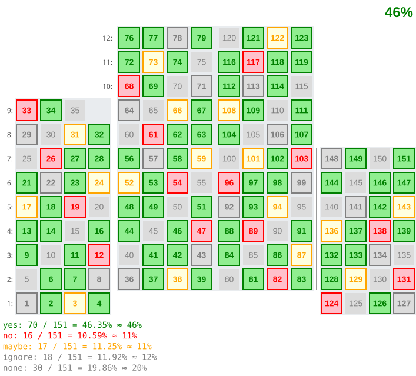

# easy-house

Draws an apartment building in SVG: every flat is a square, placed where it is in the house. Made for the site of
a housing association — to show on one picture who voted for a decision, who has paid, which flats are rented out,
and to open the card of a flat when it is clicked.



You describe an ordinary floor once and then only where the house differs from it: sections of different height,
several entrances, a shorter top floor, duplexes, an arch, a slope, floors below the ground, numbers that skip or
start again. easy-house numbers the flats the way houses are usually numbered and lays them out; how they look is
up to plugins.

**[Docs, examples and a playground](https://liksu.github.io/easy-house)**

## Install

```bash
npm install easy-house
```

```js
import {House} from 'easy-house';

const house = new House('#house', {
    units: 5,
    floors: {
        to: 9,
        1: [1, 2, 3, 'S', 'C'],     // the ground floor: a salon and a concierge take no number
        9: 3                        // three flats on the top floor
    },
    hover: true
}, {
    4: {reaction: 'yes'},           // the state: data about the flats, by number
    7: {reaction: 'no'}
});

house.on('unit:click', ({unit}) => console.log(unit.config.id, unit.state));
house.update({7: {reaction: 'yes'}});      // redraws only the flat 7
```

Without a bundler, an import map keeps the same import:

```html
<script type="importmap">
    {
        "imports": {
            "easy-house": "https://unpkg.com/easy-house@1.0.1/index.js",
            "svg-easy-tree": "https://unpkg.com/svg-easy-tree@1.0.4/tree.js"
        }
    }
</script>
```

## What is in it

* **A short config.** Every key has a default and is written only where the house differs: on the house, a
  section, an entrance, a floor or a flat; the lower level overrides the upper one.
* **Numbering as in real houses.** Continuous by default; explicit numbers, numbers as strings (`'25/1'`), labels
  without a number, holes, duplexes, merged flats, right to left, numbering that starts again in every section.
* **The building and the data apart.** The config is the building; the state is the data about the flats, keyed
  by the flat number. `house.update()` redraws only what changed.
* **Everything drawn is a plugin.** Squares, floor numbers, dividers, colours by votes with the percent and the
  legend, stacks, walls, a roof, text blocks, a highlight under the pointer, marks in the corners. Replace any of
  them or write your own: a plugin returns a description of SVG, not DOM.
* **Themes.** A palette of named colours (`'$unit'`) and the themes `light`, `dark` and `night`.
* **Small houses in one word.** `size: 'xs'` — a house of a few pixels a flat, for a list of houses.
* **Without the DOM.** `resolve`, `layout` and `scene` are pure functions: test a config or a plugin in Node.
* **Types.** `index.d.ts` comes with the package.

The only dependency is [svg-easy-tree](https://www.npmjs.com/package/svg-easy-tree); there is no build step.

## License

MIT
